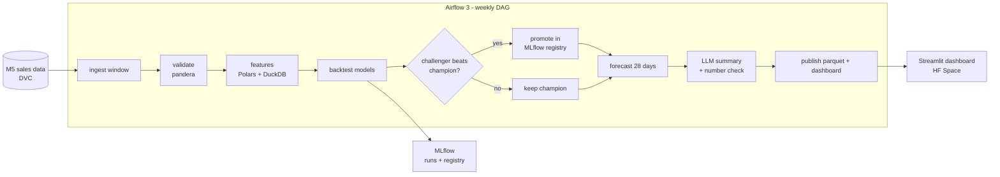

# Roadmap

> Weekly retail demand forecasting run by Airflow: retrain, compare challenger against
> champion, promote only if better, and publish a dashboard with an LLM-written summary.

Status: **planned** · no milestone started. A milestone is finished when its heading ends in "(done)".

## What it does

Every week (or on demand) the pipeline:

1. pulls the latest sales window,
2. validates it (schema, missing days, outliers),
3. builds features,
4. backtests several models on the last N weeks,
5. compares the best challenger against the current champion in MLflow,
6. promotes it only if it wins on the agreed metric,
7. writes 28-day forecasts with prediction intervals for every item and store,
8. generates a short management summary with an LLM, grounded only in the numbers produced,
9. publishes a dashboard.

## What it proves

- Time-series modelling at retail scale: hierarchical data, intermittent demand, intervals.
- Honest model comparison: classical vs gradient boosting vs time-series foundation models.
- Orchestration: Airflow 3 DAGs, retries, backfills, data checks, idempotent tasks.
- MLOps: champion/challenger promotion in the MLflow model registry, reproducible runs.
- Responsible LLM use: the LLM writes the narrative, it never produces the numbers, and every
  figure it mentions is checked against the forecast table.

Distinct from the other repos: no chat agent, no GPU, no fine-tuning of LLMs. Tabular and
time-series work, which is most of the day-to-day at retail and CPG companies.

## Architecture



## Stack and why

| Need | Choice | Why |
|---|---|---|
| Orchestration | **Airflow 3** (TaskFlow API) | most requested orchestrator in German DS/ML job ads; asset-aware scheduling |
| Data processing | **Polars + DuckDB** | fast on a laptop or a 2-core VM, no Spark needed |
| Data validation | **pandera** | schema checks as Python code, light compared to Great Expectations |
| Baselines | **statsforecast** (seasonal naive, ETS, Croston for intermittent items) | fast, standard references |
| Main model | **LightGBM** global model | LightGBM ensembles won the M5 accuracy competition; strong, fast baseline to beat |
| Foundation models | **Chronos** and **TimesFM** (small variants, CPU) | zero-shot comparison: when do they beat a tuned GBM? |
| Hierarchy | **hierarchicalforecast** reconciliation | forecasts add up from item to store to state |
| Tracking | **MLflow** runs + model registry with `champion` alias | promotion is a registry operation, auditable |
| LLM summary | small open model through an OpenAI-compatible API (or Ollama locally) with structured output | cheap; the output is a short structured report |
| Dashboard | **Streamlit** | reads the published parquet; free CPU Space |
| Infra | Docker Compose locally; Helm on k3s for the hosted version | |

## Data

- **M5 Forecasting (Walmart)**: daily unit sales for about 3,000 products across 10 stores in
  3 US states, roughly 5 years, with prices, calendar events and SNAP days. Public on Kaggle.
- Hosted pipeline runs on a subset (one state, two categories) to fit a free 2-core VM;
  full-data results are produced offline and reported in the README.
- Weekly "new data" is simulated by releasing the historical data week by week, so the DAG
  has something real to process on every run.

## Evaluation

| Metric | Why |
|---|---|
| WRMSSE | official M5 metric, weights items by revenue |
| MASE per level (item, store, state) | scale-free accuracy at each level of the hierarchy |
| 80% / 95% interval coverage | are the intervals honest? |
| Bias | over- vs under-forecasting has different business cost |
| LLM summary: number consistency | every number in the text must match the forecast table (automatic check) |

Backtesting uses rolling origin over the last 8 weeks, never a single split.

## Milestones

### M0 - Skeleton
uv project, CLAUDE.md harness, Makefile, CI, DVC with M5 download script, pandera schemas.
**Exit:** `make check` green, data pulled and validated reproducibly.

### M1 - Models and honest backtest
Baselines, LightGBM, Chronos and TimesFM zero-shot, rolling backtest, MLflow logging,
comparison table in the README.
**Shows:** time-series depth; a clear answer to "are foundation models worth it here?"

### M2 - Airflow pipeline
Airflow 3 DAG with the steps above, retries, idempotent writes (re-running a week overwrites,
never duplicates), backfill for past weeks, champion/challenger promotion.
**Shows:** orchestration and MLOps

### M3 - Hierarchy and intervals
Reconciliation across item/store/state, conformal or quantile intervals, coverage tracked over
time.
**Shows:** forecasting that a planning team can actually use

### M4 - LLM summary and dashboard
Structured summary (top movers, risks, events next month) generated from the forecast table,
automatic number check, Streamlit dashboard with history of champion metrics.
**Shows:** grounded GenAI on top of classical ML

### M5 - Hosted and monitored
k3s on the Oracle free ARM node (or Docker Compose on a small VPS), Airflow + MLflow + Postgres,
weekly run on schedule, data drift report (price and demand distribution vs training window),
alert on failed runs.
**Shows:** a system that runs by itself, week after week

## Demo and hosting

| Level | What | Cost |
|---|---|---|
| Always works | website page: video of a DAG run, backtest table, dashboard screenshots | $0 |
| Live | Streamlit dashboard on a free HF CPU Space, reading the latest published forecasts | $0 |
| Production path | Airflow + MLflow on Oracle Always Free ARM (2 OCPU / 12 GB) | $0 |

Everything is CPU, so this is the cheapest project to keep fully live. Demo script for an
interview: open the dashboard, trigger the DAG in the Airflow UI, show the MLflow comparison,
show the promoted model and the regenerated summary.

## CI/CD

- PR: lint, mypy, unit tests (features, metrics, number checker), DAG import test
  (every DAG loads, no cycles), a 2-week mini backtest on a 20-item sample.
- Main: build images (pipeline, dashboard), push to GHCR, deploy to the k3s node.
- Weekly: the DAG itself; a failed run opens a GitHub issue.

## Repo layout

```
dags/weekly_forecast.py
src/forecast/{data,validate,features,models,backtest,reconcile,promote,summary}.py
dashboard/app.py
deploy/{docker-compose.yml,helm/}
tests/
CLAUDE.md  Makefile  docs/adr/
```

## Risks

- Full M5 is large (about 59 million item-day rows: 30,490 series x 1,941 days). Mitigation: subset for hosted runs, Polars
  and DuckDB for offline runs.
- Foundation models may lose to LightGBM. That is a fine result; report it honestly.
- 12 GB RAM is tight for Airflow + Postgres + MLflow + training. Mitigation: LocalExecutor,
  training on the subset, or a small paid VPS if needed.

## Interview talking points

- Why WRMSSE and rolling-origin backtests instead of one train/test split.
- When a foundation model helped (cold-start items) and when it didn't (stable fast movers).
- How promotion works and why a model can never silently get worse in production.
